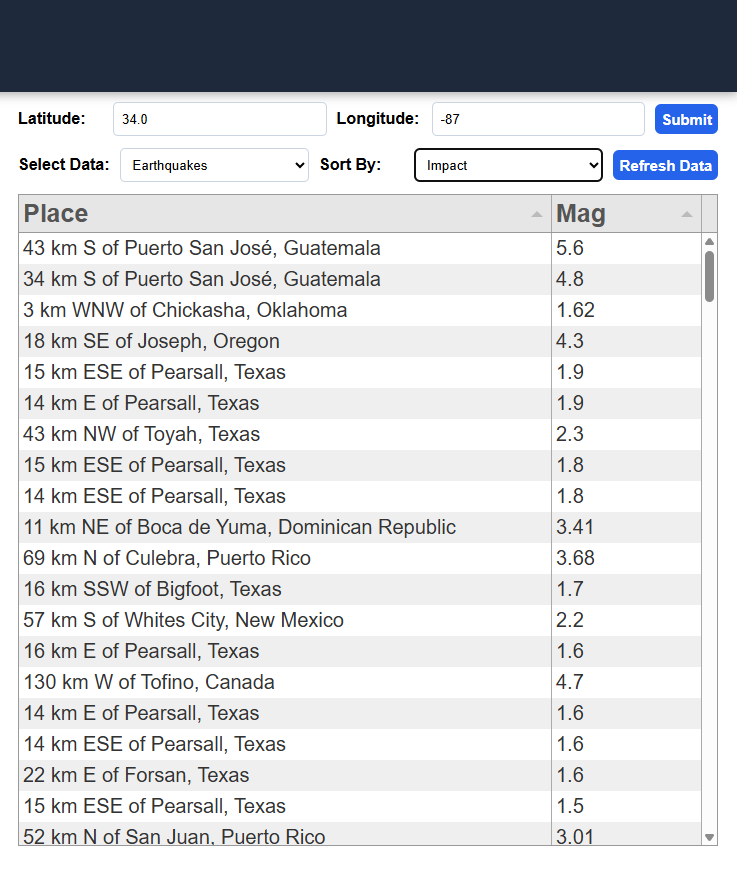

# QuakeWarn
QuakeWarn is a C program that downloads and parses shelter and earthquake data into an HTML interface for visualizing. The main sorting and
parsing logic is written and C, and a web server is created with the help of Mongoose to send data to the frontend.




## Installation

### Prerequisites

    - Linux/GNU
    - Clang
    - Make
    - Git
    - npm

### Libraries

Download libcurl for downloading data by running:

```bash
sudo update
sudo apt install libcurl4-openssl-dev pkg-config
```

Then clone the repository into a directory and install all JavaScript libararies:

```bash
git clone https://github.com/lhuang6/QuakeWarn.git
npm install
```

### Compiling and running

Compile the final binary for the web server and run:

```bash
make clean
make
./quakewarn
```

Open up http://localhost:8000 to see the final interface!
