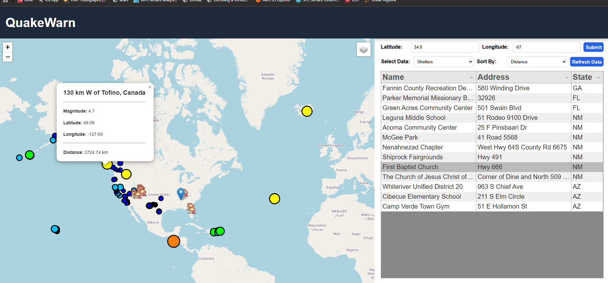

# QuakeWarn
QuakeWarn is a C program that downloads and parses shelter and earthquake data into an HTML interface for visualizing. The main sorting and
parsing logic is written and C, and a web server is created with the help of Mongoose to send data to the frontend.



## Installation

### Prerequisites

    - Linux/GNU
    - Clang
    - Make
    - Git

### Libraries

Download libcurl for downloading data by running:

```bash
sudo update
sudo apt install libcurl4-openssl-dev pkg-config
```


## Compiling
Make the project using

```bash
make
```
And run

```bash
./quakewarn
```
